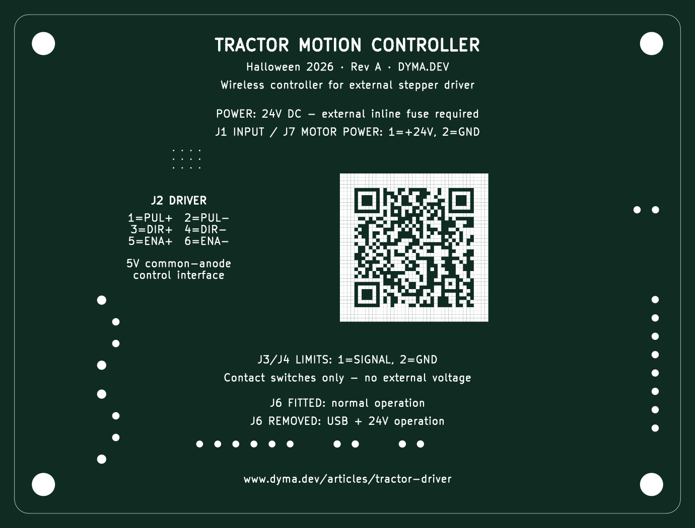

# Base controller — tractor motion control

A KiCad learning project for a wireless, chain-driven Halloween tractor prop. A Seeed XIAO ESP32-C6 controls an external DM542-class stepper driver, reads two limit switches, and exposes spare I/O and test points. The board includes 24 V power distribution, a protected logic branch, and a 24 V-to-5 V converter.

**Initial design complete; verification in progress. Not ready to order.** The 92 × 69 mm, two-layer PCB is routed. Checks on 2026-09-20 report zero ERC issues, zero unconnected PCB items, and zero schematic/PCB mismatches. PCB DRC also passes with zero errors or warnings after updating U3’s thermal-via footprint. There has been no hardware bring-up. See the [verification checklist](docs/verification.md).



## Open the design

Use **KiCad 9.0.6** with its standard symbol and footprint libraries installed. Open [base-controller.kicad_pro](base-controller.kicad_pro) in KiCad's project manager, then open the schematic or PCB.

Project-local `Halloween` libraries are registered through checked-in, project-relative library tables. No global custom-library setup should be needed. Some parts lack 3D models; that does not mean their PCB footprint is missing.

| Directory | Contents |
|---|---|
| [`docs/`](docs/) | Architecture, parts, decisions, verification, and release procedure |
| [`docs/history/`](docs/history/) | Earlier schematic, placement, and routing notes |
| [`libraries/`](libraries/) | Project-local symbols and footprints with provenance |
| [`previews/`](previews/) | Selected board and layout images |
| [`scripts/`](scripts/) | Optional local KiCad checks and manufacturing export helper |

See the [board changelog](CHANGELOG.md) for revision notes and the [repository overview](../README.md) for other boards.

## Design reference

- [Architecture, connector pinouts, GPIO map, and rationale](docs/architecture.md)
- [Parts list and JLC links](docs/parts-list.md)
- [Power protection and driver-interface decisions](docs/electrical-decisions.md)
- [External power supplies, inline fuse, and cable recommendations](docs/non-pcb-components.md)
- [Library provenance and changes](libraries/README.md)
- [Sourcing research](docs/parts-sourcing.md) — dated stock snapshots, including superseded candidates
- [Historical schematic review](docs/history/schematic-review-notes.md) — not the current issue list

The controller uses **24 V nominal input**. Motor supply power passes through to J7; the onboard eFuse protects the logic branch only. Remove **J6** before using USB with external power. The DM542 driver, motor, power supply, inline fuse, mechanics, firmware, and audio controller are external to this PCB. The 5 A pass-through figure is a design target, not a tested rating.

## Checks and releases

Save the project, then optionally run **from the repository root**:

```sh
python3 base-controller/scripts/build_hardware.py check
```

This checks a copy, refills zones, runs ERC/DRC and schematic parity, and produces review files under `build/base-controller/check/`. The current design passes these automated checks; the manual verification checklist still applies. It does not modify your KiCad sources.

Gerbers and drill files belong in **GitHub Releases**, not the source tree. Releases are prepared manually; there is no GitHub Actions workflow. Follow [the release procedure](docs/releases.md) to use either KiCad's GUI or the local script, inspect the outputs, and attach ZIPs to a tagged release.

The printed QR code points to [the future project article](https://www.dyma.dev/articles/tractor-driver).

## License

Original hardware and design documentation: [CERN-OHL-P-2.0](../LICENSE). Original scripts: [MIT](../LICENSES/MIT.txt). Imported library material keeps its upstream licenses; see [NOTICE.md](../NOTICE.md).
