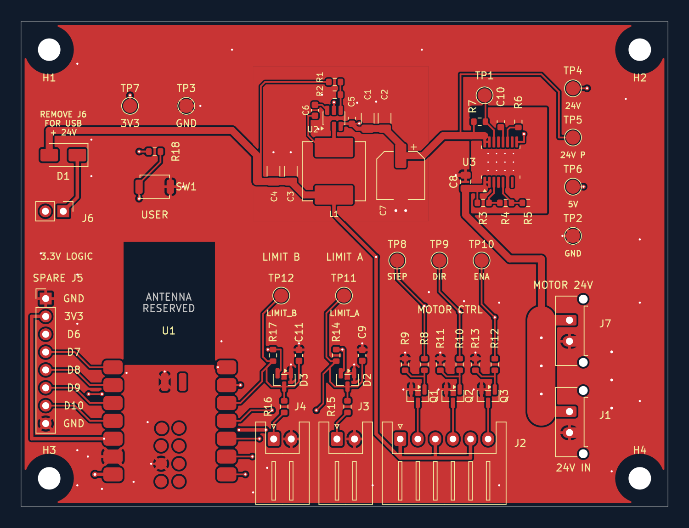
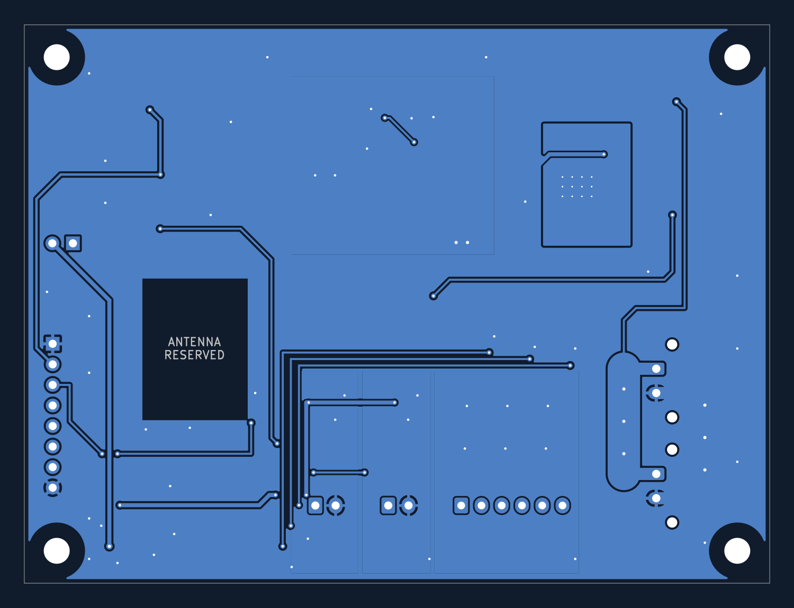

# Routing between sections

The two-layer board is now fully connected in KiCad. This is a completed routing draft, not a manufacturing release. All 63 footprint positions, all pad net assignments, existing silkscreen, and the 167 previously routed track/via objects were preserved.

## Power routing

| Connection | Routing |
|---|---|
| J1 → J7 raw 24 V | Parallel front/back 4 mm trunks, with short 1.5 mm connections to through-hole pads and additional 0.8/0.4 mm vias. |
| J7 → J1 power return | Parallel front/back 4 mm trunks and short 1.5 mm pad connections, also joined into board GND. Motor return is not forced through the logic section. |
| Raw 24 V → C8 / eFuse IN | 1 mm front trace branching from the raw supply trunk. |
| eFuse OUT → C7 | 1 mm front trace into the converter bulk-input capacitor. |
| Converter → D1 | 1 mm front trace from the output-capacitor rail, not the thin feedback-sense trace. |
| Converter → J2 positive-input bus | 0.5 mm front trace from the main output rail. |
| J6 → XIAO VBUS | 0.5 mm feed, mostly on the back; the physical jumper remains the only J6.1–J6.2 bridge. |
| XIAO 3V3 → spare header / limits / button | 0.5 mm distribution and 0.3 mm low-current branches. |

The wide copper is intended for the earlier 5 A pass-through target. It does not establish a tested rating: copper thickness, connector/contact behavior, actual supply/fuse coordination and enclosed temperature still need verification. The eFuse continues to protect only the logic branch.

## Signal routing

STEP, DIR and ENABLE use parallel back-layer runs from the MCU, then front-layer drops into the existing series resistors. Their test pads remain connected. The limit signals join the filtered nodes, not the raw contact inputs. A short back-layer bridge carries LIMIT_A across the other input circuit.

Four spare GPIOs fan out on the front. D6 crosses under the MCU on the back, with a short front bridge to cross the USB power feed. The button trace runs around the antenna reservation. New control-signal traces are 0.25 mm wide; ordinary new vias are 0.6 mm diameter / 0.3 mm drill.

## Ground and mechanical clearances

- Added front/back board GND pours and distributed stitching vias. Local GND pours retain their connection settings with priority 2; board pours use priority 0.
- The eFuse's separate RTN areas remain priority 10 on both layers. RTN is not connected to GND. This retains the separation described in [TI's TPS2660 documentation](https://www.ti.com/lit/ds/symlink/tps2660.pdf).
- Preserved the MCU antenna reservation on both layers, and preserved the converter's local layout. See [TI's LMR51420 layout guidance](https://www.ti.com/lit/ds/symlink/lmr51420.pdf).
- Added 3.5 mm-radius copper/track/via keepouts around the four mounting holes for screw-head/washer clearance. Actual chosen hardware must fit that allowance.
- Filled copper can comprise several regions joined through vias and the other layer. KiCad reports no isolated filled regions in this draft.

## Editing from here

The existing functional groups remain, but they are now connected to one another. Moving a section independently will break its external routes. New routes, planes, stitching vias and mounting-hole keepouts belong to `15 Inter-section routing - reroute before moving sections`. Enter that group to edit individual items; do not move the entire group casually. Ungrouping does not itself change electrical connectivity.

## Verification

Saved-board DRC: **0 unconnected items**, no new routing/clearance/silkscreen errors. The only 12 violations are the existing U3 thermal holes: footprint drill 0.2 mm versus the project's 0.3 mm minimum. That footprint/fabrication choice was not changed or waived.

All original footprints and routed tracks were preserved byte-for-byte when saving. New via/track net assignments were checked after zone filling. At the end of this routing pass, before adding the QR footprint and final back silkscreen, board totals were 273 track segments and 85 vias. Schematic/BOM and hardware performance were not revalidated by this routing pass.

Remaining before manufacturing: resolve the U3 thermal-hole issue; final electrical, thermal/current, assembly and mechanical reviews; verify enclosure/plug access and chosen supply/driver; then export and inspect manufacturing files. Hardware bring-up remains necessary.

The original local report is `reports/interconnect-drc.json`. Regenerate current checks with the [local export workflow](releases.md); generated reports are not committed.

Backup before routing: `base-controller/placement-backups/before-inter-section-routing-20260919-231230.kicad_pcb`.
