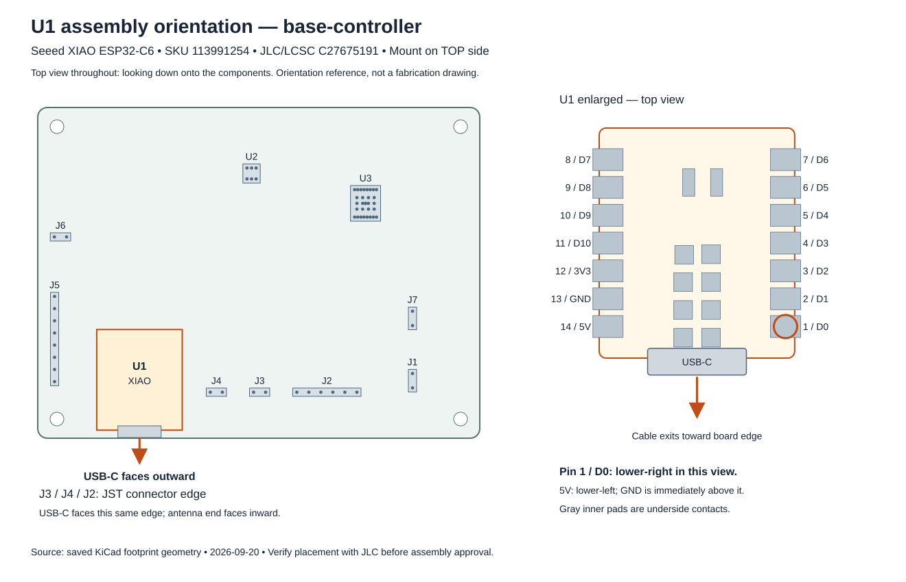

# U1 assembly reference

This documents the intended placement of U1; it is not approval of JLC's manufacturing placement or a complete assembly review.

- U1: Seeed XIAO ESP32-C6, SKU **113991254**, JLC/LCSC **C27675191**.
- Mount on the **top** of the carrier PCB, with the module's USB-C connector facing outward toward the **J2/J3/J4 connector edge**.
- In the top view shown below, footprint pad **1 / D0** is at the lower-right, **14 / 5V** is at the lower-left, and **13 / GND** is immediately above 14.
- Align the castellated and underside contacts with the carrier footprint. Do not infer the placement from the tiny placeholder in JLC's viewer.

The drawing uses the saved KiCad footprint geometry as of 2026-09-20. Gray contacts inside the module outline are underside contacts shown for alignment. The connector bodies/USB graphic are illustrative; this is not a dimensioned fabrication drawing.

The current Fabrication Toolkit CPL reports U1 at X **128.857719 mm**, Y **-118.530500 mm**, rotation **180 degrees**, top. These are exported placement conventions, not independently confirmed coordinates for JLC's component model. Ask JLC to reconcile its origin and rotation with the numbered pads and physical USB direction shown here.

## Message to JLC — draft, not sent

> U1 (Seeed XIAO ESP32-C6, SKU 113991254, C27675191) displays only a checkerboard placeholder in the assembly preview, so I cannot verify its placement. Please confirm its placement against the attached top-view reference: mount on the top side with USB-C facing outward toward the same board edge as J2/J3/J4. Footprint pad 1/D0 is lower-right and pad 14/5V is lower-left in that view. Please verify the castellated and underside contacts, and reconcile the CPL origin/rotation with your assembly library. Please provide a placement drawing showing U1 for my review before assembly.

Use **Confirm Parts Placement** and review the returned DFM/placement file, following the confirmation deadline shown by JLC. This U1 reference does not resolve the separate U3 thermal-pad/via assembly review.

## References

- [Seeed XIAO ESP32-C6 hardware overview and pin map](https://wiki.seeedstudio.com/xiao_esp32c6_getting_started/)
- [Local footprint](../libraries/Halloween.pretty/XIAO-ESP32-C6-SMD.kicad_mod)
- [Board verification checklist](verification.md)
