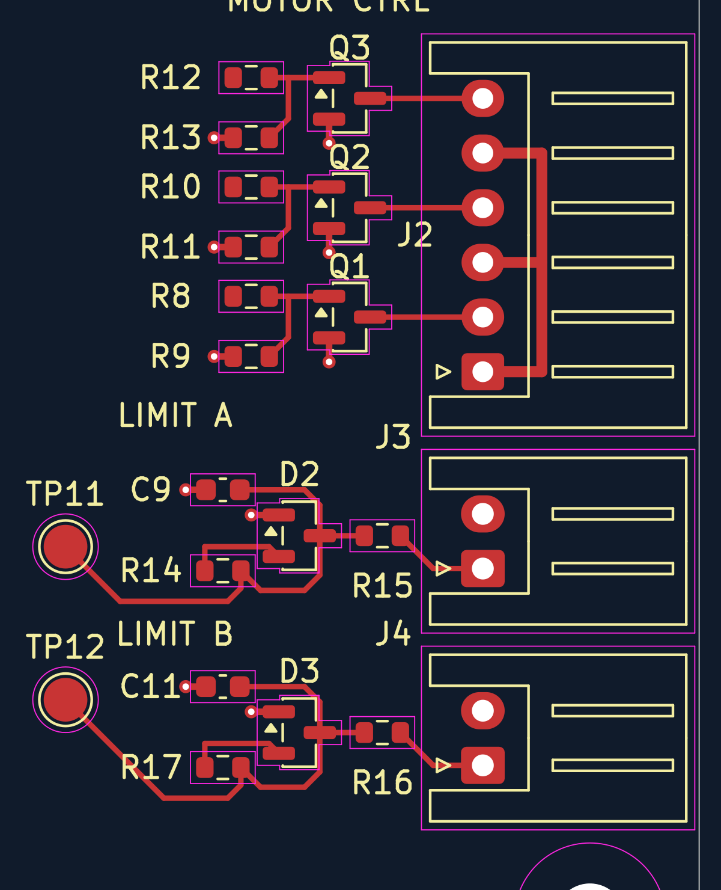

# J2–J4 local routing — 2026-09-19

> Design history: positions, counts, and pending-work statements below describe that stage of development. See [current verification status](../docs/verification.md) before making changes or ordering.

**Later modularity update:** the shared back ground zone described below has been split into three independent local zones, and each I/O circuit is now a movable group. See [section interfaces](section-interfaces.md) for current connections, grouping and verification. The trace routes below are unchanged.

This pass routes only the motor-control interface and two limit-input circuits. It does not finish the board or connect these sections to the ESP32 or main supplies.

## Motor-control channels

- R8/R10/R12 output pads connect to Q1/Q2/Q3 bases, with branches to R9/R11/R13 pulldowns.
- The pulldowns were rotated 180° in place so their base pads face the short base traces. Values, nets, and center positions are unchanged.
- Q1/Q2/Q3 collectors connect directly to J2 pins 2/4/6 respectively.
- J2 pins 1/3/5 share a 0.5 mm front-copper +5 V bus on the connector side of the pin row. Copper beneath the connector's plastic body is intentional; its through-hole pads remain correctly isolated by net.
- Transistor emitters and pulldown ground pads each have short front traces to ground vias.

## Limit inputs

- J3/J4 signal pads connect to the input sides of R15/R16.
- The filtered sides connect to D2/D3 signal pads, C9/C11, R14/R17, and TP11/TP12.
- Each clamp's +3V3 pad connects locally to its pullup resistor's +3V3 pad.
- Capacitor and clamp ground pads have nearby vias; connector ground pins connect directly to the back ground zone through their plated holes and thermal spokes.
- The two input circuits use the same route pattern. Their +3V3 feeds are still separate physical islands pending the board-wide power routing.

## Layers and dimensions

All new signal traces are on **F.Cu**, 0.25 mm wide. Short ground stubs are 0.3 mm; the shared J2 +5 V bus is 0.5 mm. Ten ground vias use 0.6 mm diameter and 0.3 mm drill.

One local **B.Cu GND** zone covers x=85.5–110.5, y=69.5–105 mm. It uses 0.2 mm clearance and thermal pad connections (0.3 mm gap, 0.35 mm spokes). This zone connects local ground returns, but is not yet connected to the main board ground. Integrate it with the eventual board-wide ground plane, maintaining the separate eFuse RTN island and antenna clearance. The original converter zones and routing are unchanged.

The front-only preview intentionally hides the back copper so the routes are visible. The [ground preview](previews/io-routing-ground.png) shows the local back plane, which obscures front traces in the combined SVG rendering. In KiCad, toggle filled-zone visibility or select F.Cu to inspect the front paths.

## Remaining connections and verification

Still to route: STEP/DIR/ENABLE feeds to R8/R10/R12, the corresponding TP8–TP10 and ESP32 connections, LIMIT_A/B back to the ESP32, +3V3 feeds to both limit circuits, +5 V feed to J2, and the connection of local ground to the main board ground.

Saved-board DRC: 12 existing U3 thermal-drill violations, no new violations; unconnected items decreased from 95 to 61. All eight exclusively local nets (three transistor bases, three driver sink outputs, and two raw limit inputs) have no remaining unconnected items. This checks local connectivity and clearance, not electrical operation or completed board grounding.

A backup was saved under `placement-backups/before-io-routing-*`. The pass added 60 track segments, 10 ground vias and one ground zone; only R9/R11/R13 were rotated, with all other footprint blocks and preexisting copper preserved.
