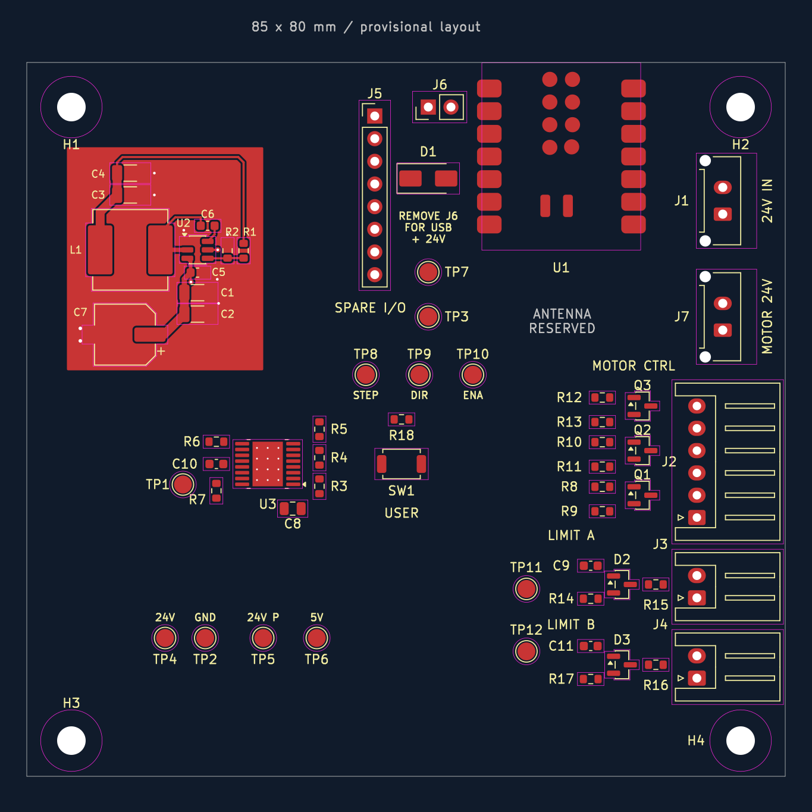

# Overall placement draft — 2026-09-19

> Design history: positions, counts, and pending-work statements below describe that stage of development. See [current verification status](../docs/verification.md) before making changes or ordering.

**Current handoff:** [movable section interfaces](section-interfaces.md) describes the completed local routing, named groups and remaining connections. It supersedes the placement-only coordinates/status below where later user edits differ.

**Later routing update:** the local J2–J4 circuits are now routed; R9/R11/R13 were rotated in place. See [I/O routing notes](io-routing-notes.md) for the current routes, checks and remaining connections. The placement-only DRC counts below describe the earlier snapshot.

The board now has a provisional **85 × 80 mm** outline and an initial placement of all components. This is a routing starting point, not a manufacturing release. No new electrical connections were routed during this pass, and the schematic was not changed.

## Arrangement

- The existing buck remains at upper left. Its eleven footprints, all 56 existing track/via objects, and both filled ground zones were preserved byte-for-byte.
- The eFuse section sits below the buck. It was subsequently shifted and turned 180° as a complete block: U3 is now at (54,78) mm, input pins toward the right and output pins toward the left/converter. The reviewed internal component spacing is preserved. Its future `EFUSE_RTN` copper must remain separate from `GND`.
- J1 and J7 sit together along the right side, above J2. J7's motor power cable and J2's control cable go to the same driver, so keeping them together makes the harness easier to bundle. Both footprints are rotated 90°, with J1 at (105,50) and J7 at (105,63) mm. Both remain vertical/top-entry connectors; their pin rows now run along the edge. Plan short, broad 24 V and ground distribution between them, with a separate logic branch running to the eFuse. The intended 5 A pass-through capacity remains a design target to verify when routing. Mated-plug/latch access still needs physical/model review; passing courtyard checks alone does not establish finger clearance.
- The XIAO sits at the top edge, USB facing outward. J6 and D1 moved to its left to make room for the power connectors; J6 remains accessible, with its USB/24 V warning. Spare I/O J5 sits farther left.
- J2/J3/J4 face outward along the right edge. Q1–Q3 and their base resistors/pulldowns are grouped beside J2; each limit filter/clamp group is beside its connector.
- SW1 remains accessible in the middle. Power test pads form a row near the bottom edge; signal test pads sit near their respective sections. They can still move during routing.

## Mechanical and RF reservations

The outline runs from (27,33) to (112,113) mm. Four `MountingHole:MountingHole_3.2mm_M3` footprints are PCB-only, excluded from assembly BOM and placement files. Centers are (32,38), (107,38), (32,109), and (107,109) mm. Their courtyards reserve screw-head space. Confirm enclosure/standoff dimensions before committing to this outline; the driver enclosure's mounting pattern has not been matched.

A two-layer rule area reserves carrier copper clearance at the XIAO antenna end, x=80.5–93.5 and y=51.5–69 mm. It prohibits tracks, vias, and copper pours. Pads/footprints are allowed so the mounted XIAO itself is not rejected; **do not place other components in this reserved region**.

The antenna location was checked against Seeed's published PCB: ANT1 is KH5220-A36 at the end opposite USB. These carrier keepout dimensions are a conservative draft, **not a manufacturer-approved carrier specification**. Review antenna guidance, actual module revision, and nearby enclosure/driver metal before manufacture, then validate radio performance in the assembled enclosure.

Sources: [Seeed XIAO ESP32-C6 documentation](https://wiki.seeedstudio.com/xiao_esp32c6_getting_started/) and its [published PCB project](https://files.seeedstudio.com/wiki/SeeedStudio-XIAO-ESP32C6/XIAO_ESP32_C6_v1.0_SCH%26PCB_260114.zip).

The imported XIAO footprint's body/USB silkscreen intersected its own pads and extended outside the carrier at USB. These graphic primitives now live on `F.Fab`, in both the board instance and local footprint library. Its pads and electrical numbering are unchanged. The U1 reference remains on silkscreen. Enable F.Fab to see the USB/body depiction.

## Checks and next steps

- No courtyard overlap, copper clearance, short-circuit, silkscreen overlap, edge, or library mismatch violations in the final DRC.
- The 12 existing U3 thermal-hole drill violations remain: its footprint uses 0.2 mm holes versus the project's 0.3 mm minimum. Resolve the fabrication/footprint choice before manufacture; constraints were not relaxed.
- 95 unconnected items remain, as expected for this partially routed board.
- Existing pad nets and component values were preserved. Four mounting holes are the only added footprints.
- The present buck ground zones are still local zones. Integrate them with the final ground arrangement while respecting the eFuse RTN island and antenna rule area.

Next: route the eFuse block, then power distribution and the other local circuits. The outline, connector positions, and test-pad positions may need small adjustments as routing develops. Complete DRC/ERC, mechanical review, and fabrication checks before ordering.

Backup of the board and original XIAO footprint: `placement-backups/before-overall-placement-20260919-185225/`.

Subsequent power-connector regrouping preserved Dylan's moved power test pads and all other components/routing. Only J1, J7, J6, D1 and their associated labels changed. DRC still reports only the 12 existing thermal-drill violations plus 95 unconnected items. The 85 × 80 mm outline remains provisional; a different aspect ratio or an enclosure-driven outline is possible before final routing.

Latest revision: rotated J1/J7 90° and repositioned the complete eFuse block as described above. The converter, other component placements, and Dylan's test-pad row were preserved. Final DRC remains 12 existing thermal-drill violations and 95 unconnected items, with no new violations. A board backup was saved under `placement-backups/before-power-port-rotation-*`.
