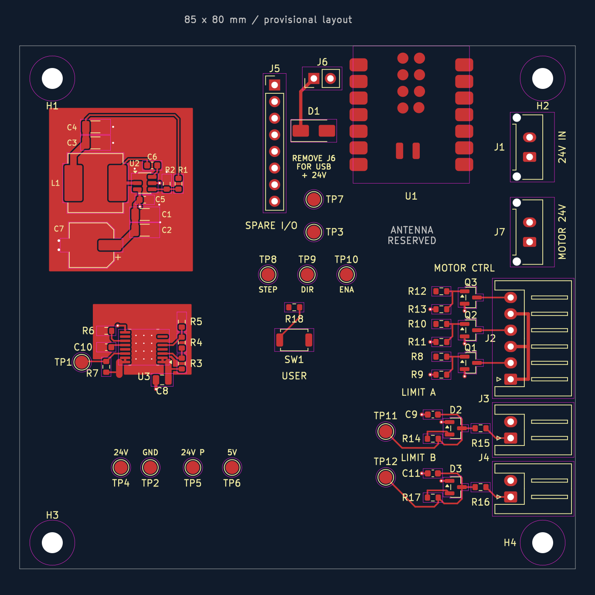
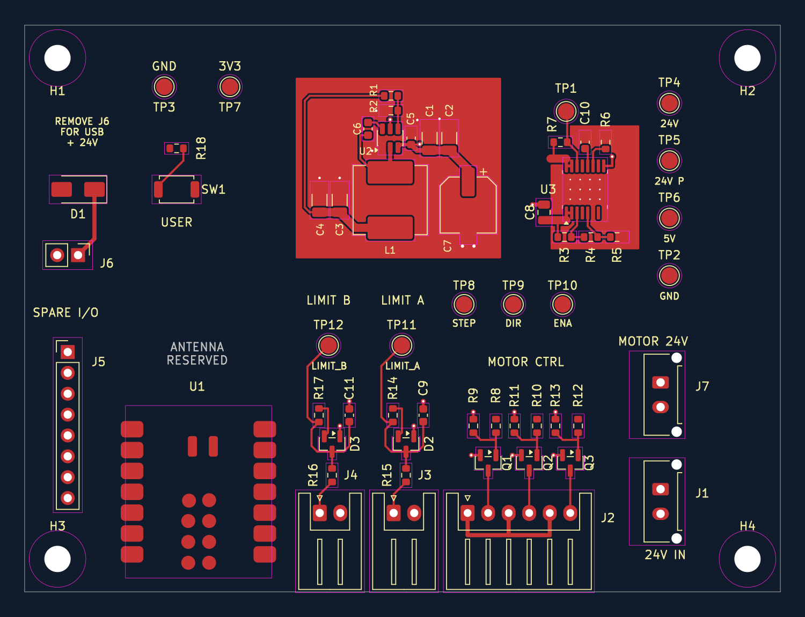
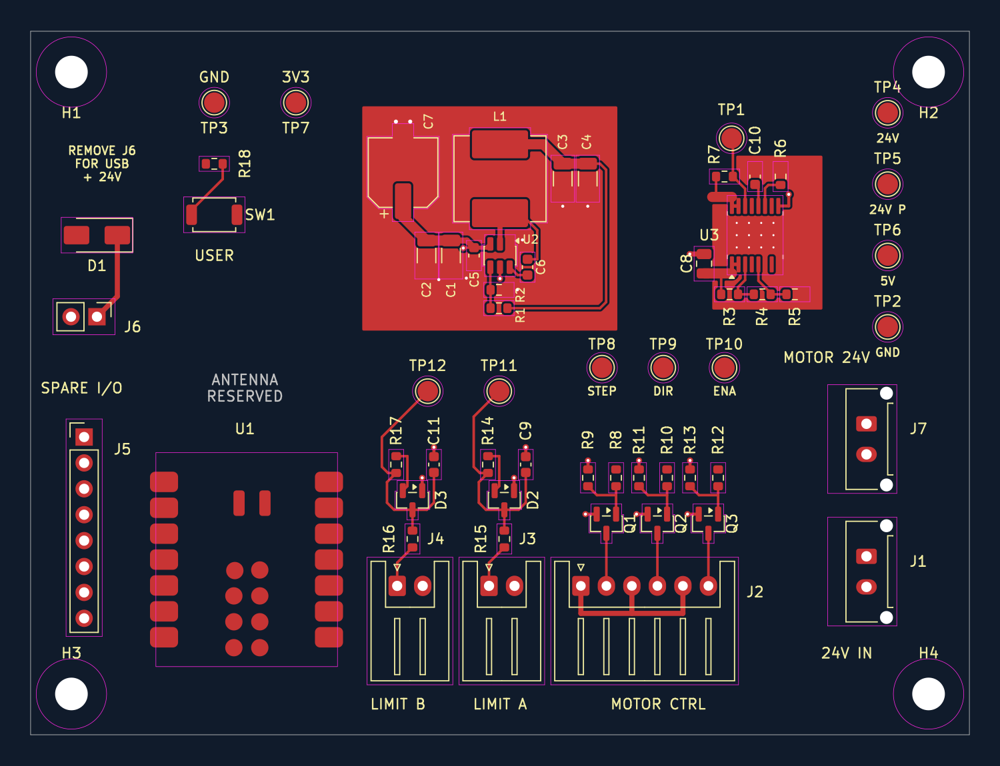
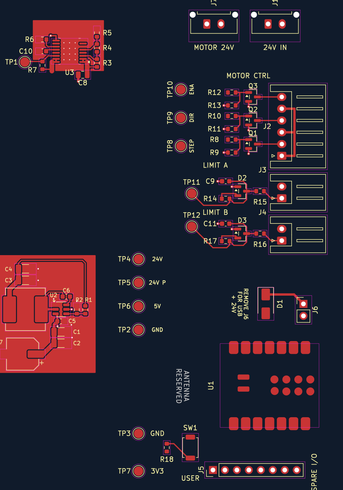

# Movable circuit sections

> Design history: positions, counts, and pending-work statements below describe that stage of development. See [current verification status](../docs/verification.md) before making changes or ordering.

The sections are now interconnected, with zero unconnected items in the saved-board DRC. See [the current routing notes](interconnect-routing-notes.md). **Sections can no longer move independently without adjusting their external routes.** The historical placement notes below describe earlier stages.

These are **logical interfaces on one PCB**, not separate daughterboards. Existing pads and copper serve as connection points; no extra electrical components or connectors were added.

## Latest: front connector access

Moved the complete MCU/antenna group and J2–J4 routed groups **5 mm toward the front edge** (positive Y). Based on their F.Fab outlines, USB mouth Y=142.867 mm and JST mouth Y=142.6 mm now sit about 0.13 mm and 0.4 mm behind the Y=143 mm board edge. The MCU's antenna reservation follows it. Relocated the connector function labels behind the row. Preserved Dylan's converter rotation and repaired limit test-point routes.

All locally routed sections remain internally connected. DRC: 12 existing thermal-hole errors, 42 remaining unconnected items; no new clearance or silkscreen violations. Final enclosure openings and actual cable-plug clearance still require mechanical review; these measurements describe the nominal footprint geometry.

## Latest: compact layout facing the connectors

The working orientation now has the USB and J2–J4 cable openings facing the bottom of the canvas. A provisional **92 × 69 mm** outline encloses the packed layout; mounting holes were moved to its corners. Connector-body, mated-plug and enclosure access still need the final mechanical review.

The MCU moved toward the limit inputs; J5 and the power jumper sit to its left, with the jumper behind the front connector row. The button is behind the MCU. The buck and eFuse blocks occupy the space behind the I/O. Their full routed groups, copper zones and the MCU antenna reservation moved together. Test pads are arranged around these blocks. Functional silkscreen reads from the connector-facing edge; small passive references retain vertical text where it fits better.

All 167 tracks/vias and all pad net assignments were preserved. DRC: 12 existing thermal-hole errors, 42 intentionally remaining unconnected items, no new clearance/courtyard/silkscreen errors, and no internal missing connection within the seven routed sections. Inter-section routing and final mechanical review remain to do.

The sections below describe earlier placement passes and may contain superseded coordinates/previews.

## September 19: taller layout and I/O access

Dylan rearranged the connectors and rotated the MCU so USB faces the same right-hand side as J2–J4. The latest support-placement pass preserves all connector and MCU positions, along with the existing motor-control and limit-input routing. It moves the button below the MCU, brings the STEP/DIR/ENA test bank alongside the driver channels, and places the supply test pads in a labeled vertical bank. TP3 (GND) and TP7 (3V3) are now in their own group, `14 MCU test pads - UNROUTED`, below/left of the MCU and outside its antenna reservation. J6 remains in Dylan's new position above the MCU.

The old outline was removed during rearrangement. Final outline, mounting-hole placement, power-block placement and inter-section routing remain unsettled. Saved-board DRC after this pass: 12 existing thermal-hole errors, missing outline, and 42 unconnected items; no new placement violations. The older coordinates and preview below describe the earlier arrangement.

## Section connection table

`C7.1` means pad 1 of C7. Net names remain the source of truth when choosing a connection point; group membership does not connect anything electrically.

| Group / section | Inputs from the rest of the board | Outputs / external connections | Ground / notes |
|---|---|---|---|
| 01 Buck converter | `24V_PROTECTED` at C7.1 or its broad input distribution | `+5V` at C3.1 / C4.1 and their broad output trace | `GND` at C7.2 or the local ground zones. Do not take load power from the thin R1 feedback-sense trace. |
| 02 eFuse | `24V_IN` at C8.1 / its 1 mm input track | `24V_PROTECTED` at U3.15/16 and the 1 mm output track; TP1 is the fault test point | Ordinary `GND` at C8.2 or U3.9. **EFUSE_RTN is internal to this section and must not be joined to GND.** TP1 has a protected-24 V pullup, not a 3.3 V interface. |
| 03 Motor-control interface | `STEP` at R8.1, `DIR` at R10.1, `ENABLE` at R12.1; `+5V` at the shared J2.1/3/5 bus | J2.2 = PUL−, J2.4 = DIR−, J2.6 = ENA−; all six J2 pins go to the external driver | `GND` through the local back zone and Q1–Q3 emitter pads. This is driver-control current, not motor winding/supply current. |
| 04 Limit A | Contact cable on J3.1/2; `+3V3` at R14.2 | Filtered `LIMIT_A` at TP11 / C9.1 / R14.1, to ESP32 | `GND` at J3.2 / local back zone. J3.1 is the raw contact input; the MCU connects after R15. |
| 05 Limit B | Contact cable on J4.1/2; `+3V3` at R17.2 | Filtered `LIMIT_B` at TP12 / C11.1 / R17.1, to ESP32 | `GND` at J4.2 / local back zone. J4.1 is the raw contact input; the MCU connects after R16. |
| 06 USB power link | Converter `+5V` at D1.2 (anode) | J6.2 to XIAO VBUS, U1.14 | D1.1 connects to J6.1. The removable shunt connects J6.1/2; no trace bridges the jumper. Remove it for simultaneous USB and 24 V operation. |
| 07 User button | `+3V3` at R18.1 | `DEBUG_BTN` at SW1.1 / R18.2, to ESP32 | `GND` at SW1.2. |

The motor driver’s bulk 24 V power path, J1 → J7, remains separate from the eFuse logic branch and is not routed yet. The final design still needs its intended 5 A pass-through copper capacity checked.

## What changed in this pass

- Routed U3's local input/output pins, threshold divider, current-limit resistor, slew capacitor and fault pullup/test point.
- Added top and bottom `EFUSE_RTN` copper islands, directly connected to the exposed thermal pad and local RTN components. Their priority is 10, to preserve them when lower-priority ground zones are eventually added. The existing plated thermal holes join the two RTN layers.
- Routed the C8-to-U3 ordinary-ground return with two ground vias and a back-layer trace around the exposed thermal pad. It remains electrically separate from the RTN islands.
- Routed D1 cathode to J6.1, and the button/pullup signal connection.
- Split the previously shared J2–J4 back-ground zone into three independent local zones. This permits motor control, Limit A and Limit B to move independently. Their ground connections to one another and the rest of the board must be added during final routing.
- Created 13 named groups. Groups 01–07 are locally routed circuits. Groups 08–13 hold the unrouted MCU/antenna reservation, spare header, power connectors and test-pad banks. Each section's associated labels move with it.
- Preserved every existing footprint position, track, via and drawing. In particular, Dylan's latest move of the eFuse block to U3=(46,79.1) mm was retained. Only the shared I/O ground zone was replaced.

New tracks: 0.25 mm for control signals; 0.35 mm short paired eFuse power-pin fanouts; 1 mm local eFuse power trunks; 0.5 mm D1–J6 connection and back bypass return. New vias: 0.6 mm diameter / 0.3 mm drill. These local routes do not establish a finished board current/thermal rating.

The RTN arrangement follows [TI TPS2660 layout guidance, pages 39–40](https://www.ti.com/lit/ds/symlink/tps2660.pdf). Validate input transients, thermal behavior and grounding after final integration and on hardware.

## Moving a section in KiCad

1. Select a member of the section. KiCad normally selects its whole group and displays the group name; confirm that the complete section is highlighted.
2. Use **M** to move or **R** to rotate the selected group. Its footprints, tracks, vias and local zones move together.
3. To edit one item inside it, use **Enter Group** from the right-click menu, or double-click the group. Use **Leave Group** or Esc when finished.
4. Refill zones with **B**, then run DRC after rearranging. Avoid overlapping another section's copper, the antenna reservation, mounting-hole clearances or the board edge.

The MCU group includes its antenna rule area. Mounting holes and the provisional board outline remain separate so the mechanical layout can change. Once connections between groups are routed, moving a group will also require adjusting those connections.

When adding tracks while editing later, check that they are included in the intended group; a newly drawn item is not automatically guaranteed to belong to it. Group properties let you inspect/add members. See [KiCad 9 groups documentation](https://docs.kicad.org/9.0/en/pcbnew/pcbnew.html#groups).

## Verification and remaining work

- Final saved-board DRC: **12 existing U3 thermal-drill violations; no new violations; 42 unconnected items**.
- The 42 missing connections are between sections or within deliberately unrouted sections. No unconnected pair is internal to any of routed groups 01–07.
- All 167 track/via objects belong to exactly one group. All non-mounting-hole footprints are grouped. Moving the eFuse group was checked on a temporary copy to confirm every member's position moved together.
- Each local copper zone has one connected filled region. RTN is distinct from GND, and the local group ground islands are deliberately not yet joined.
- The existing 0.2 mm U3 thermal holes still conflict with the project's 0.3 mm minimum. Resolve the footprint/fabrication choice before ordering; the constraint was not relaxed.
- Final connector placement, shape, antenna/enclosure clearance, inter-section routing, power distribution, overall ground planes, and manufacturing review remain to do.

Backup: `placement-backups/before-modular-sections-20260919-200953.kicad_pcb`.
