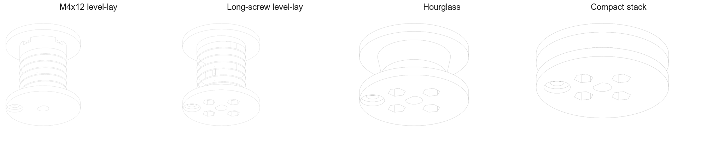

# DC motor rope spool prototypes

These are three printable spool concepts plus a short-hardware variant for the
measured 31.97 mm four-hole flange coupling on an 8 mm D-shaft motor.  The
generator preserves editable, parametric source and exports both STEP and STL
files.



## Recommendation

With the available 12 mm screws, start with the **M4x12 helical level-lay
spool**.  Four ordinary M4 nuts slide into radial windows directly behind the
rear cheek, and the screws enter through the metal flange from the hub side.
The screw stack is only the metal flange, 3.8 mm of printed bearing material,
and the nut.  The windows live in a reserved ungrooved collar so the rope cannot
run across the hardware openings.

The original long-screw **helical level-lay spool** remains available for later.
Its 5.5 mm-pitch shallow guide
keeps nominal 5 mm rope in a single side-by-side layer.  The 34 mm root diameter
holds about 850 mm of 5 mm rope in one layer, so the requested 305 mm pull uses
about 2.5 turns while three or more full wraps remain on the drum.  This is the
least likely design to bunch or wedge, provided a fairlead keeps the incoming
rope approximately tangent to the drum.

Print the **flange fit gauge** first.  It checks the bolt circle, D passage, and
32.3 mm pilot recess in a few minutes and avoids committing to a full spool if
the particular coupling differs from the measurements.

## Designs

| Model | Overall size | Behaviour | Trade-off |
| --- | --- | --- | --- |
| M4x12 helical level-lay | 54 mm diameter x 56 mm | Six guided wraps plus a protected nut-access collar; uses the existing 12 mm screws | Nuts must be slid into four side windows during assembly |
| Helical level-lay | 54 mm diameter x 53 mm | Seven guided, side-by-side wraps; best resistance to bunching | Longest print and needs about M4x55 hardware |
| Hourglass self-centering | 54 mm diameter x 29 mm | Smooth waist encourages the rope toward the middle; tolerant of imperfect rope diameter | Rope can still cross over itself without a fairlead |
| Compact stack | 60 mm diameter x 17 mm | Forces the rope into one narrow radial stack | Effective diameter and line speed change most; stacked rope can pinch under high load |

All spool versions are below the stated 80 mm maximum axial width.

## M4x12 assembly

1. Print the `helical-level-lay-spool-m4x12` model with the metal-flange pocket
   on the build plate.
2. Slide one ordinary M4 nut radially into each of the four collar windows.  The
   hex-shaped inner end prevents the nut from rotating.
3. Place the spool over the metal flange and align the four holes.
4. Insert the M4x12 socket-head screws from the hub side and start all four nuts
   before tightening any one screw.
5. Tighten in a cross pattern.  Do not crush the printed plastic.

Do not add washers with the 12 mm screws; the extra stack thickness reduces
thread engagement.  The nut bears against a solid 3.8 mm printed section, while
the 32.3 mm pilot pocket locates the spool and shares radial/shear loading.  A
small amount of removable threadlocker can be applied to the metal threads only
after the geometry has been test-fitted.

## Shared flange interface

- Four 4.60 mm clearance paths on a 24.05 mm bolt circle.
- 32.30 mm diameter x 1.20 mm deep rear locating pocket over the measured
  31.97 mm metal flange.  This pilots the spool and lets the rim share shear
  load instead of asking the screws alone to locate it.
- 8.37 mm D passage with its flat 3.305 mm from centre.  This is the supplied
  best-fit profile plus 0.12 mm radial print allowance.
- Front hex sockets capture normal 7 mm-across-flats M4 nuts.  Insert M4
  socket-head screws from the metal-flange/hub side, slide the spool over them,
  and place the nuts in the accessible spool-side sockets.  The sockets prevent
  the nuts from turning, so only the rear screw heads need a hex key.
- A bellmouthed 6.20 mm rope becket hole runs through the outer cheek at 45
  degrees between two mounting screws.  Feed the rope through from the drum
  side and tie a figure-eight or double-overhand stopper in the 12 mm outer
  recess.  Leave a short tail.

The two measured ways of inferring the mounting-hole circle differ by about
0.25 mm (23.92 mm from edge distances versus 24.17 mm from opposing inner
edges).  The selected 24.05 mm centre value and 4.60 mm holes allow both.

## Motion and rope handling

With 5 mm rope on the preferred spool, the first-layer rope centreline is about
39 mm in diameter.  At 90 rpm the line speed is approximately 184 mm/s, so one
foot takes about 1.7 seconds.  Running around 45--60 rpm gives roughly a
2.5--3.3 second pull.

Use a smooth eyelet or pulley fairlead near the spool.  Put it on the tangent
line, approximately centred over the active groove.  The spool groove prevents
most wandering, but a completely unconstrained rope can still jump a flange.
Keep at least three complete wraps on the drum at full extension.  The friction
of those dead wraps should carry almost all working tension; the stopper knot is
a tail retainer, not the primary load-bearing connection.

## Printing

- Print with the metal-flange pocket on the build plate and the motor axis
  vertical.  No support should be needed except possibly a small amount inside
  the front hardware pockets, depending on bridging quality.
- PETG, ASA, nylon, or a tough PLA are reasonable prototype materials.  Start
  with 5 perimeters, 5 top/bottom layers, and 40--60% infill.  For substantial
  or safety-critical load, use nylon/CF-nylon and test to a suitable factor of
  safety; these models are not load-rated.
- Deburr the rope hole and groove.  A sharp printed seam will quickly fuzz
  soft rope.
- Check that all four fasteners seat evenly and do not bottom out in the metal
  flange.  Hardware length depends on whether the coupling holes are threaded
  or through-holes; likely starting points are M4x55, M4x35, and M4x20 for the
  helical, hourglass, and compact designs respectively.
- The recessed nuts bear against solid drum material, not a thin flange skin,
  so washers are not needed under them.  If space permits, washers may be used
  under the screw heads on the metal side, although the metal flange normally
  provides an adequate bearing surface by itself.

For the two hub set screws, equal-length cup-point M4 set screws with removable
blue threadlocker on the **metal threads only** are preferable to uneven long
screws.  Protruding screws can snag rope and add rotational imbalance, so keep
them as short as practical and add a guard if they remain exposed.  Degrease the
shaft and screw threads before applying threadlocker.

## Generate

From the repository root, with the listed Python dependencies installed:

```sh
python -m pip install -r tractor-assembly/rope-spool/requirements.txt
python tractor-assembly/rope-spool/generate_rope_spools.py
```

Generated files are in `output/`.  Change the constants near the top of the
script to tune printer clearance, rope diameter, bolt circle, D profile, or
spool geometry and rerun it.

## Measurements worth confirming after the fit gauge

The current models are printable prototypes.  Before treating one as final,
confirm whether the four metal-flange holes are M4 threaded or plain, the metal
flange thickness, how far the motor shaft protrudes beyond the flat face, and
the maximum expected rope tension.  Those determine final hardware length and
whether the printed material is suitable for the load.
